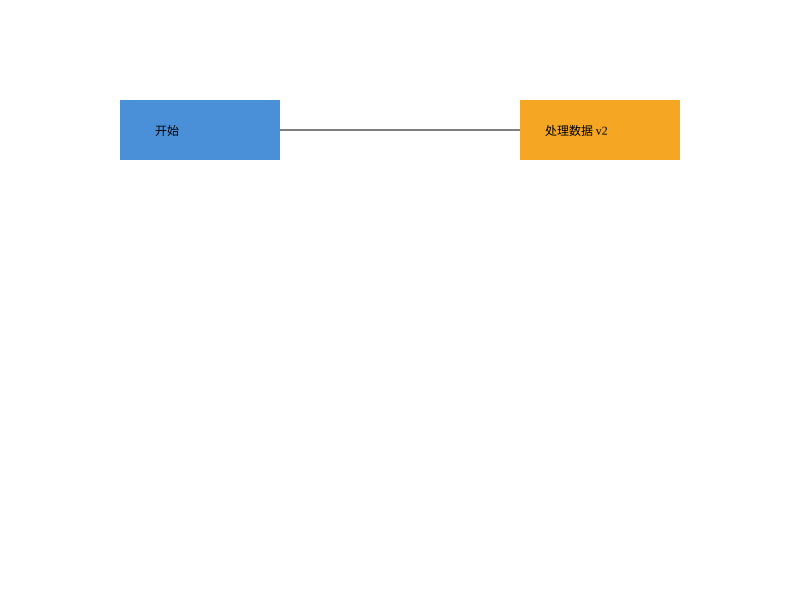

# SVG Editor — Lab1 Phase 1

TypeScript 面向对象命令行 SVG 编辑器。支持六种图形、组合容器、文件读写以及命令级撤销重做。

## 运行

安装 Node.js 22 或更新版本，然后在项目根目录执行：

```sh
npm ci
npm run cli
```

在当前 Windows 工作区中也可直接运行 `powershell -File scripts/cli.ps1`，使用已准备好的 `.tools/` 本地 Node 环境。该环境不提交到仓库；克隆到其他电脑时请先安装 Node.js。

```text
svg> init 800 600
svg> create g node
svg> create rect r 120 100 160 60 #4a90d9 in node
svg> create text t 155 135 "开始" in node
svg> move node 0 100
svg> undo
svg> tree
svg> save demo.svg
```

输入 `help` 查看所有命令。Ctrl+C 或输入 EOF 退出。交互终端显示 `svg>`；管道输入不显示提示符，以便脚本回放。

## 验证与示例

```sh
npm test
npm run demo
```

`npm run demo` 以 UTF-8 回放 [示例命令](examples/flowchart.commands)，生成 [flowchart.svg](examples/flowchart.svg)。可直接用浏览器打开。



完整作业报告、架构方案、协作过程、需求对照与已知边界见 [doc/README.md](doc/README.md)。原始要求见 [phase_cli_1.md](phase_cli_1.md)。开发在 `lab1` 分支，最终验收点使用 `final` 标签。
