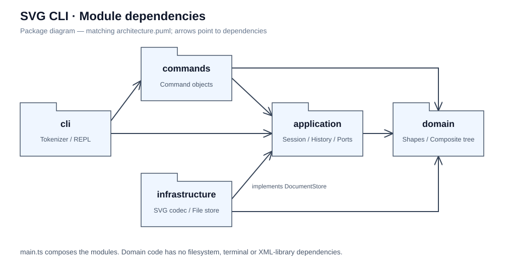
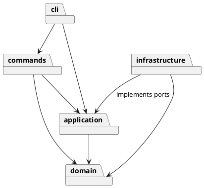
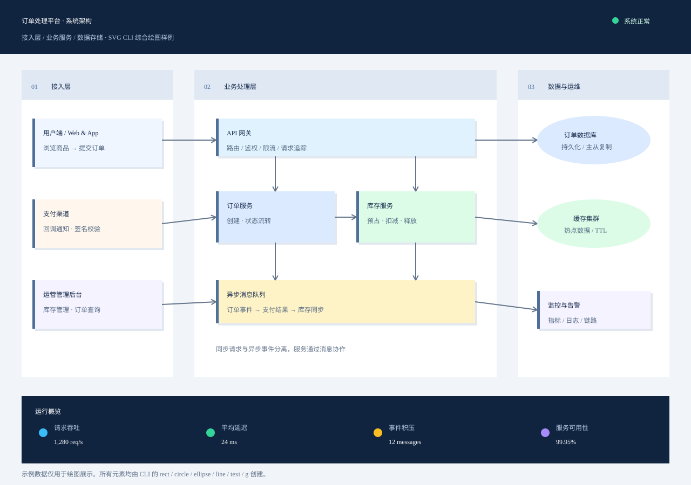

# Lab1 Phase 1：SVG 命令行编辑器

**项目仓库（提交分支 `lab1`）：[https://github.com/fggf233/AdvancedSE/tree/lab1](https://github.com/fggf233/AdvancedSE/tree/lab1)**

本报告对应上述分支，源代码、测试、示例及分阶段提交记录均可在该分支查看。

## 架构方案

采用 TypeScript、面向对象及一类一文件。目标为作业规定的六种 SVG 元素、全部 CLI 命令和撤销重做；不实现后续阶段的 box 插件。

运行：Node.js 22+，执行 `npm ci`、`npm run cli`。验证：`npm test`；示例：`npm run demo`。Windows 推荐 `scripts/run.cmd cli`（或 `test`、`demo`），在脚本局部设置本地 Node 的 PATH，不依赖 PowerShell 脚本执行策略；原 `scripts/cli.ps1` 仍保留为可选入口。

| 模块 | 职责 | 允许依赖 |
|---|---|---|
| `src/domain` | 图形行为、组合树、标识与文档不变量 | 同模块，无 Node.js、CLI、XML 库依赖 |
| `src/application` | 会话、历史和输入输出端口 | domain |
| `src/commands` | 每条命令的参数契约及执行，编辑命令持有撤销状态 | application、domain |
| `src/infrastructure` | SVG XML 编解码和文件存储 | application 端口、domain、Node.js、XML 库 |
| `src/cli` | 分词、命令分发、错误格式化和终端循环 | commands、application |
| `src/main.ts` | 组装依赖并启动 | 各模块 |



附 [PlantUML 源文件](architecture.puml)。SVG 是与源文件对应的本地绘制包图；未下载 PlantUML 渲染器，不将其冒称为 PlantUML 工具输出。CLI 的终端 IO 由 `Repl` 独占；其他 CLI 类不读取文件。



设计模式：Command 将编辑操作封装为对象；编辑命令持有执行前后的文档快照，以 Memento 思路保证分组/删除等复杂操作可整体撤销。Composite 让 Group 和叶子共享 Shape 接口，通过多态递归移动、缩放、复制。图形工厂统一 CLI 创建与 XML 导入；存储端口隔离文件系统，便于内存测试。

具体落地：`Command.execute(EditorSession)` 是统一入口；十个编辑命令继承 `EditCommand`。`EditCommand.perform` 先克隆当前文档，在副本上执行 `apply`，成功后才保存前后快照。`History` 只在成功后更新两个栈，因此连递归缩放中途溢出也不会污染原文档。`undo/redo` 恢复命令对象持有的快照，而非重新解析旧命令字符串。

`Shape` 封装 ID、父级和属性，属性查询返回副本；`GeometryShape` 共享几何计算，Rect/Circle/Ellipse/Line/Text 声明各自几何字段；Text 覆写文本行为，Group 覆写递归行为。树的 ID 查找、分组和层次操作由 `SvgDocument` 负责。分组属于纯结构操作，不复制旧父容器的继承样式；普通 `g` 的 `set fill` 写到容器自身，按 SVG 规则继承。

只保留两处按名字分派：`CommandDispatcher` 的命令注册表与 `ShapeFactory` 的类型注册表。按作业要求，两者标为后续插件化阶段的待重构点；本阶段不添加插件加载机制。属性白名单校验属于数据校验，不按图形标签分派。

变化点：新增图形通过 Shape 子类和工厂注册；新增入口通过会话接口；替换文件存储实现 DocumentStore；新增命令通过命令类及分发注册。暂不为多人协作、完整 SVG/CSS 渲染和插件生命周期预留实现，因为超出 Phase 1。

待明确语义采用以下约定并以测试固定：分组按文档先序排列被选节点，新组位于其最近公共容器中最早被选分支的位置；`front` 是视觉最前（SVG 同级数组尾），`back` 是数组头；文档操作成功后清空历史并锁定，下一条成功编辑开启新历史；`help` 可在无文档时使用。

补充约定：`init w` 使用默认高度 600；`canvas` 修改必须同时提供宽高。首次显式 `save file.svg` 后记住路径，后续 `save` 可复用；`init` 清除此路径。坐标允许负数和浮点，尺寸/半径/stroke-width 不得为负，画布尺寸及缩放因子必须为正。错误命令不改变文档、默认文件路径、undo/redo 栈或锁定状态。

## 过程记录

- 2026-10-23：阅读原始任务，确认 box 是后续阶段；先提交原始要求，再创建 lab1 分支，保留真实开发历史。
- 2026-10-23：开始前确定分层和依赖方向。采用快照撤销，是为了确保跨父容器分组的父级、顺序、样式均能精确恢复；接受每次编辑 O(n) 时间和内存的教学规模取舍。
- 本记录仅描述实际发生的协作与实现，不虚构学生审阅、讨论或测试结果。后续随验证更新。
- 2026-10-23：用户明确要求先创建 `lab1` 分支并保留多次提交；实现工作均在该分支完成，未将开发内容合并到 main。
- 领域阶段：加入继承行为、容器递归和 ID 校验，通过 5 项测试后提交 `9fb34f6`。
- 命令阶段：确认“错误命令不改变任何状态”也包含 redo 栈与 IO 锁。加入溢出发生在第二个子节点时的回归测试，验证第一个子节点也不留下修改；9 项测试通过，提交 `0fba951`。
- 文件和 CLI 阶段：将 XML 解析交给 @xmldom/xmldom，而不是正则解析 XML；先扫描文件全部显式 ID，再生成缺失 ID。分词器保留参数是否加引号，避免将文本 `"in"` 误认成父容器语法。17 项测试通过，提交 `ead45c2`。
- 自查阶段：发现根节点未知绘图属性会被忽略，改为拒绝导入，防止无声丢失外观。补充跨父级分组、各种结构操作的精确撤销/重做以及模块依赖检查，20 项测试通过，提交 `42bfe45`。
- 工具适配：本机无可直接运行的 Node.js，下载官网便携包并核对 SHA-256，放在 Git 忽略的 `.tools/`。TypeScript 7 需要显式 Node 类型配置，且不提供旧编译器 API，架构检查改为直接导入/声明的静态约定检查；不声称等同于完整语义分析。
- 示例验证：实际运行作业流程图命令，生成 8 个元素；使用隔离配置的 Edge 无界面模式渲染，检查了中文、两矩形与连线。PlantUML 工具查询未获批准，保留可编辑源文件并本地绘制对应包图。

阶段历史可用 `git log --oneline --reverse` 核对；最终文档更新和验收标签在上述功能提交之后完成。

### 用户运行反馈修正

- 2026-10-23：用户在自己的 PowerShell 中运行 `scripts/cli.ps1`，遇到系统禁止执行脚本。代理环境的终端测试没有覆盖该执行策略差异。新增 `scripts/run.cmd` 统一支持启动、测试和示例，保持系统执行策略不变，并修正运行说明。本次修正在已有 `final` 标签之后提交到 `lab1`，保留已发布标签指向的原验收版本。

### 追加测试：复杂单图绘制与预览

2026-10-23，在基础流程图样例完成后，我向 AI 提出“来个复杂的测试样例”，随后进一步明确“只需一个，图片复杂点就行”。据此，将追加验证限定为一张较复杂的完整图形，检验编辑器能否通过连续命令组织多个图形和嵌套容器，并正确输出 SVG。

实现的样例为“订单处理平台系统架构图”，画布尺寸为 **1280 × 900**，共 **130 个元素（含容器）**。图中包含接入层、业务处理层、数据与运维三个分区，以及服务卡片、数据库、缓存、消息队列、方向箭头和底部运行概览。指标数值为绘图示例数据。

验证内容包括：

- 使用 `rect`、`circle`、`ellipse`、`line`、`text`、`g` 六种类型构建同一张图。
- 使用 `create … in …` 建立分区与节点的嵌套关系，验证容器组织能力。
- 使用 `set` 设置文字颜色和线宽；用多条线段组成箭头，并通过 `front connections` 将连线放到分区背景之上。
- 连续回放命令并保存文件，检查中文文本、连接关系和图层顺序的实际显示效果。

源命令保存在 [examples/complex.commands](../examples/complex.commands)，生成结果为 [examples/complex.svg](../examples/complex.svg)。在项目根目录的 PowerShell 中可复现：

```powershell
.\scripts\run.cmd demo examples/complex.commands
Start-Process .\examples\complex.svg
```

执行结果：命令回放成功，编辑器输出 `saved to examples/complex.svg (130 elements)`；随后通过 Edge 无界面模式渲染并检查预览，中文、分区、服务节点及连线均正常显示。为支持这一需求，示例回放脚本增加了可选的命令文件参数；相关修改以独立提交 `04ff140` 保存在 `lab1` 分支。

这是对复杂图形构建、文件输出与视觉效果的集成验证，不计入原有 20 项自动化测试，也不替代撤销重做和错误处理的行为测试。



## 一致性自查

1. **模块划分一致**：实际使用 `domain/application/commands/infrastructure/cli` 五层与组装入口；另有 `test/`、`examples/`、`scripts/`、`doc/`、CI 配置。测试辅助类 `MemoryStore` 也单独放在同名文件。
2. **依赖方向一致**：检查全部生产源码的直接 import。domain 不引用应用层、Node 或 XML 库；application 只依赖 domain；commands 不接触 fs/终端；文件适配器实现 application 的存储接口。`TreeView` 放 application，避免 CLI 直接依赖 domain，此为设计细化，没有反向依赖。
3. **分派和封装**：命令名注册表仅在 `CommandDispatcher`，图形类型注册表仅在 `ShapeFactory`。生产代码无 switch，无顶层自由业务函数；一类一文件。几何字段与样式封装在类内部，Group 返回子节点数组副本。
4. **自查边界**：自动检查约束文件命名、直接导入方向和部分语法约定；不能证明所有未来动态依赖或全部设计质量。命令行为另由测试验证。允许的两个注册表仍明确列为插件化阶段待重构点。

## 质量保证手段

已在 Windows、Node 22.23.4、TypeScript 7.0.2 下执行严格编译及 **20 项测试，20 通过、0 失败**。依赖版本记录于 package-lock.json；不依赖全局 TypeScript。`npm run demo` 成功，生成的文件经浏览器实际渲染验证。

| 检查 | 证据 |
|---|---|
| 六种类型、ID、几何计算与组合树 | `test/domain.test.ts` 的 5 项测试 |
| 命令撤销粒度、redo 清空、IO 锁、失败原子性 | `test/history.test.ts` 的 4 项测试 |
| 所有 CLI 命令、必需错误、真实子进程、分词、跨父级分组 | `test/cli.test.ts` 的 6 项测试 |
| XML 往返、自动 ID 冲突、畸形输入、真实文件 IO | `test/svg.test.ts` 的 4 项测试 |
| 类文件名和模块依赖约定 | `test/architecture.test.ts` 的 1 项测试 |

需求对照：

| 要求 | 实现位置 |
|---|---|
| init/read/save/canvas | 同名命令类、EditorSession、FileDocumentStore |
| create 的六类型与 in 子句 | CreateCommand、Arguments、ShapeFactory |
| delete/move/scale/set | 对应命令类、Shape/GeometryShape/Group 的多态行为 |
| group/ungroup/addto/front/back | 对应命令类、SvgDocument |
| tree/show/help | TreeView 与对应命令类 |
| undo/redo 与 IO 屏障 | EditCommand、History、EditorSession |
| SVG 文件、缺 ID 警告、转义 | SvgCodec、FileDocumentStore |
| 输入注释、双引号、统一错误 | Tokenizer、CommandRunner、Repl |
| 分阶段远程提交 | lab1 分支的真实 Git 历史，最终 final 标签 |

保存先写同目录临时文件再重命名，写失败时保持原文件及会话历史。CLI 中失败命令报告错误并继续接受下一行。管道回放省略交互提示符，便于自动化；UTF-8 示例脚本通过 Node 读取，避免旧版 Windows PowerShell 管道默认编码损坏中文。

GitHub Actions 已配置 Ubuntu 和 Windows 的 `npm ci`、测试、示例回放。远程运行状态的 API 查询返回 403，因此这里只确认配置已推送和本地测试结果，不声称远程 CI 已通过。

### 范围与已知边界

- 支持作业六类元素及规定属性的 SVG 子集。读取支持可选 namespace、px 画布尺寸、匹配画布的 `viewBox`。不支持 path/use/CSS、transform、任意 viewBox、text 的嵌套 tspan、DTD/实体声明或其他扩展属性；遇到不支持内容报错，保持当前文档。本阶段的移动/缩放直接修改几何属性，不生成 transform。
- `box`、插件加载和图形界面不在 Phase 1 范围；`create box` 按要求报未知类型。SVG 导入也不尝试恢复插件复合类型。
- tree 使用完整 `width/height` 属性名，而非示例中的 `w/h` 缩写；move/undo/redo 的成功摘要措辞不同，但包含执行结果、类型/ID，功能与错误约定一致。
- 快照历史随编辑次数和文档大小增长，ID 查找为线性遍历。本阶段面向小型教学图形，没有引入复杂的增量快照、持久化树或空间索引。
- 课程截止日期不在原始文件中。用户仍需按课程通知确认截止时间、提交入口及仓库可见性。
