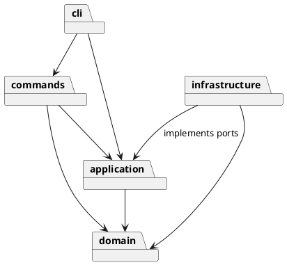

# Lab1 Phase 1：SVG 命令行编辑器

## 架构方案

采用 TypeScript、面向对象及一类一文件。目标为作业规定的六种 SVG 元素、全部 CLI 命令和撤销重做；不实现后续阶段的 box 插件。

| 模块 | 职责 | 允许依赖 |
|---|---|---|
| `src/domain` | 图形行为、组合树、标识与文档不变量 | 同模块，无 Node.js、CLI、XML 库依赖 |
| `src/application` | 会话、历史和输入输出端口 | domain |
| `src/commands` | 每条命令的参数契约及执行，编辑命令持有撤销状态 | application、domain |
| `src/infrastructure` | SVG XML 编解码和文件存储 | application 端口、domain、Node.js、XML 库 |
| `src/cli` | 分词、命令分发、错误格式化和终端循环 | commands、application |
| `src/main.ts` | 组装依赖并启动 | 各模块 |

设计模式：Command 将编辑操作封装为对象；编辑命令持有执行前后的文档快照，以 Memento 思路保证分组/删除等复杂操作可整体撤销。Composite 让 Group 和叶子共享 Shape 接口，通过多态递归移动、缩放、复制。图形工厂统一 CLI 创建与 XML 导入；存储端口隔离文件系统，便于内存测试。

只保留两处按名字分派：`CommandDispatcher` 的命令注册表与 `ShapeFactory` 的类型注册表。按作业要求，两者标为后续插件化阶段的待重构点；本阶段不添加插件加载机制。属性白名单校验属于数据校验，不按图形标签分派。

变化点：新增图形通过 Shape 子类和工厂注册；新增入口通过会话接口；替换文件存储实现 DocumentStore；新增命令通过命令类及分发注册。暂不为多人协作、完整 SVG/CSS 渲染和插件生命周期预留实现，因为超出 Phase 1。

待明确语义采用以下约定并以测试固定：分组按文档先序排列被选节点，新组位于其最近公共容器中最早被选分支的位置；`front` 是视觉最前（SVG 同级数组尾），`back` 是数组头；文档操作成功后清空历史并锁定，下一条成功编辑开启新历史；`help` 可在无文档时使用。

## 过程记录

- 2026-10-23：阅读原始任务，确认 box 是后续阶段；先提交原始要求，再创建 lab1 分支，保留真实开发历史。
- 2026-10-23：开始前确定分层和依赖方向。采用快照撤销，是为了确保跨父容器分组的父级、顺序、样式均能精确恢复；接受每次编辑 O(n) 时间和内存的教学规模取舍。
- 本记录仅描述实际发生的协作与实现，不虚构学生审阅、讨论或测试结果。后续随验证更新。

## 一致性自查

实现完成后检查目录、类名/文件名、模块依赖与分派位置，结果将在此补充。

## 质量保证手段

计划：严格 TypeScript 编译；领域行为、历史原子性、SVG 读写和 CLI 集成测试；回放作业示例，检查错误不改变状态；检查生成 SVG 可再次读取。结果在完成后记录。
